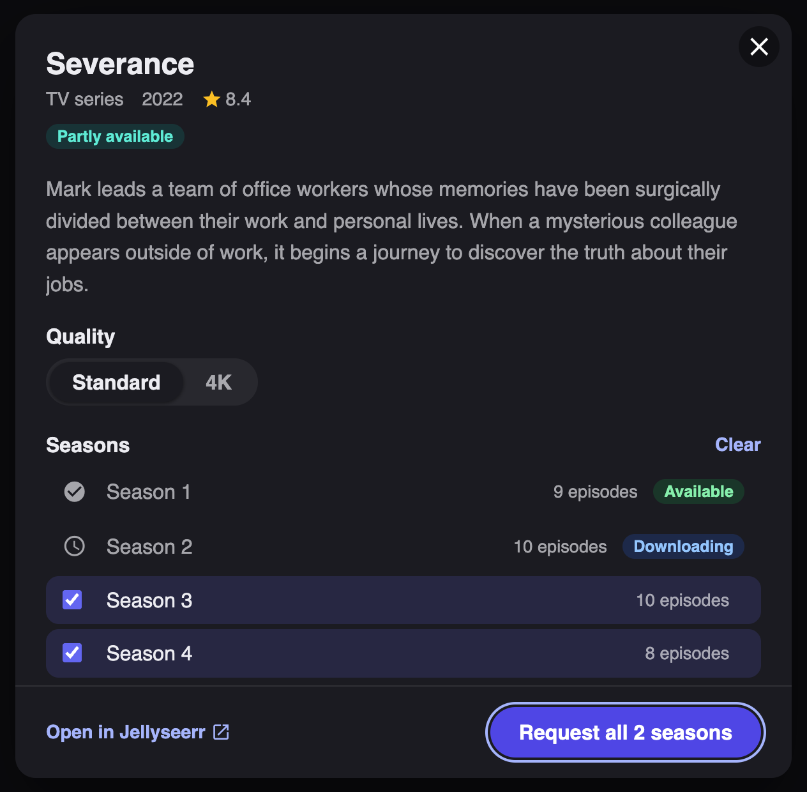
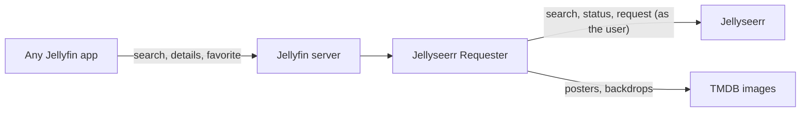

<div align="center">

# Jellyseerr Requester

**Search Jellyseerr from inside Jellyfin, and request what's missing from any app, on any screen.**


[What users get](#what-users-get) ·
[Install](#install) ·
[Configure](#configure) ·
[Client support](#client-support) ·
[Troubleshooting](#troubleshooting) ·
[How it works](#how-it-works)

</div>

---

Your users search in Jellyfin. If a movie or show isn't in your library yet, it still shows up in the results,
straight from [Jellyseerr](https://github.com/Fallenbagel/jellyseerr). One tap on the heart and the request is
on its way. There's no second app to open and no new button to learn, and it works the same on the web,
Apple TV, Android TV, iOS and Android.

<p align="center">
  
  <br>
  <sub>The optional Request dialog in Jellyfin web. In other apps, users request with the heart button.</sub>
</p>

## What users get

### 1. Missing titles in search
Library results come first. Matching Jellyseerr titles that aren't in the library yet follow in the usual
**Movies** and **Shows** rows. Their detail pages have the poster, backdrop, year, rating, genres and runtime,
and the overview starts with *"Not in your library, available to request"*.

### 2. Request with the heart
Every Jellyfin app already has a favorite button, Swiftfin on Apple TV included, so that's the request button.

| Heart on a | Requests |
|---|---|
| **Movie** | The movie |
| **Show** | Every season that isn't already available or requested |
| **Season** | Just that season (open the show, then the season) |

The heart stays filled once the request is in.

### 3. Status on the poster
Posters carry a badge that updates as Jellyseerr does its job:

| Badge | Meaning |
|---|---|
| `+ REQUEST` | Not requested yet |
| `REQUESTED` | Waiting for approval or a download |
| `DOWNLOADING` | On its way |
| `STALLED` | The download looks stuck (see below) |
| `REQUEST MORE` | Some seasons are missing |
| `AVAILABLE` | Ready to watch (shown per season) |

### 4. Downloads, and stalled ones
Requested titles show how their download is going: progress and time left from Radarr or Sonarr, or *Queued*,
*Paused*, *Importing*, *Waiting for the release*. A download is **stalled** when:

- Radarr or Sonarr report a problem with it (failed, warning such as a stalled torrent, download client unavailable),
- it hasn't progressed, or its ETA has passed, for longer than *Stalled after* (24 h by default),
- or the request was approved that long ago and nothing is in the download queue (no release found, or never sent
  to Radarr/Sonarr). Titles that aren't released yet are never stalled.

**Removing a download.** Jellyfin administrators, and users with *Manage Requests* in Jellyseerr, can remove a
download so it stops and can be requested again:

| Title | What Remove does |
|---|---|
| Movie, or show with nothing available yet | Removed from Radarr/Sonarr (with any partial files) and cleared in Jellyseerr |
| Show with some seasons already available | Its open requests are cancelled; the available seasons and their files are kept |

In Jellyfin web, the Request button turns into **Downloading** or **Stalled** and opens the dialog with the
progress and a **Remove download** button (click twice to confirm). In other apps, removing a *stalled* title from
your favorites (♥) removes it. A **Downloads** row on the web home page lists every download, stalled ones first.

> [!NOTE]
> Jellyseerr can't touch the download client itself: after a removal, Radarr/Sonarr may leave the torrent or
> NZB in the client's queue. Delete it there if it's still listed.

### 5. Trending and popular on the home page
Jellyfin web's home page gets three more rows, below Jellyfin's own sections: **Trending**, **Popular Movies** and
**Popular TV Shows**, the same lists as Jellyseerr's *Discover* page. Titles that aren't in the library carry
their status badge and open their request page. Titles already in the library get a check mark and open the
library item, or can be left out. Each row links to the full list in Jellyseerr.

### In Jellyfin web
A **Request** button replaces Play on these titles. It opens a dialog where missing seasons are already selected
(or just the season you're looking at), with an optional **Standard / 4K** choice. Play and Shuffle are
hidden, since there's nothing to play yet.

> [!NOTE]
> Requests are made **as the user's own Jellyseerr account**. Permissions, quotas, auto-approval and
> notifications all work as usual, and the API key never leaves the Jellyfin server.

## Install

1. **Check your Jellyfin version** in *Dashboard → General*, or at `http://<server>:8096/System/Info/Public`.
2. **Get the matching zip** from `dist/`, or [build it](#build):

   | Jellyfin | Zip |
   |---|---|
   | 12.x | `jellyseerr-requester_1.3.0.0_jf12.zip` |
   | 10.11.x | `jellyseerr-requester_1.3.0.0_jf10.11.zip` |

3. **Stop Jellyfin.** Extract `Jellyfin.Plugin.JellyseerrRequester.dll` into
   `<jellyfin config>/plugins/JellyseerrRequester/`, replacing any older copy. In Docker that's usually
   `/config/plugins/JellyseerrRequester/`.
4. **Start Jellyfin.** *Dashboard → Plugins* should list **Jellyseerr Requester** as *Active*.

> [!WARNING]
> Only replace the DLL while Jellyfin is stopped. Overwriting it on a running server can make that run fail when
> it shuts down.

<details>
<summary><b>Or host your own plugin repository</b></summary>
<br>

```sh
REPO_URL=https://your.host/jellyfin-plugins ./build.sh
```

Upload `dist/` (the zips and `manifest.json`) to that URL. Then add
`https://your.host/jellyfin-plugins/manifest.json` under *Dashboard → Plugins → Repositories* and install from
the catalog. Updates then arrive like any other plugin's.

</details>

## Configure

Open *Dashboard → Plugins → **Jellyseerr Requester***. The page tests the saved connection as soon as it opens.
Use **Test connection** again after changing the URL or key.

**Connection**

| Setting | What to enter |
|---|---|
| Jellyseerr or Seerr URL | The address the **Jellyfin server** uses to reach Jellyseerr, e.g. `http://jellyseerr:5055` |
| API key | In Jellyseerr: *Settings → General → API Key* |
| Public Jellyseerr or Seerr URL | Optional. The address browsers use for "Open in Jellyseerr" links |

> [!TIP]
> **Seerr** (the merged successor of Jellyseerr and Overseerr, v3 and later) works the same way: point the plugin at it
> and use its API key. Its API is the same for everything this plugin does. **Test connection** says which one it
> found, and links in Jellyfin web name it.

**Search results**

| Setting | Default |
|---|---|
| Add Jellyseerr titles to Jellyfin search | On. The main feature; the options below only apply while it's on |
| Titles per search | 20 movies and 20 shows (up to 100; more Jellyseerr result pages are read for higher numbers) |
| Leave out titles that are already fully available | On |
| Show the status on posters | On |
| Explain how to request at the top of the overview | On |

**Requests and Jellyfin web**

| Setting | Default |
|---|---|
| Let users without a Jellyseerr account request | Off. When on, unlinked users request as the API key owner |
| Offer 4K requests | Off. Adds the Standard / 4K choice; needs a 4K server in Jellyseerr |
| Request button with season picker | On. Web only; restart Jellyfin after changing it |
| Trending and Popular rows on the home page | On. Web only; restart Jellyfin after turning it on or off |
| Titles per row | 20 |
| Leave out titles that are already in the library | Off. When off, they show with a check mark and open the library item |
| Downloads row on the home page | On. Web only; restart Jellyfin after turning it on or off. Users see their own requests unless they can view all requests in Jellyseerr |

**Downloads**

| Setting | Default |
|---|---|
| Show a download as stalled after (hours) | 24 |

**Users**

| Setting | Default |
|---|---|
| Users the plugin is on for | Everyone. Untick a user to turn the plugin off for them: no Jellyseerr titles in their search, no home page rows, no Request button, and the plugin's API refuses their requests. Takes effect immediately, in every app |
| Child mode, per user | Adult. Pick an age ("Child, up to 12") to put a user in child mode |

**Child mode**

| Setting | Default |
|---|---|
| Age ratings from | United States. The stricter of this country's and the US rating is used; without either, the UK rating, then the strictest found anywhere |
| Refuse titles without an age rating | On |
| Jellyfin tags | `kids` |
| Radarr and Sonarr tags | Empty. Tags must already exist in Radarr/Sonarr |

### Child mode
A user in child mode only sees and requests titles whose TMDB age rating is at or below their age. Titles above it
are left out of their search results and of the Trending and Popular home page rows (as are unrated ones, unless
*Refuse titles without an age rating* is off). Jellyseerr results carry no rating, so the plugin looks each one up;
the first search for a term, or the first home page load, can take a few seconds longer. Titles whose rating isn't
known in time (4 seconds for search, 8 for home rows) are left out until the next try. Ratings are cached for 12 hours.

Titles a child requests are tagged automatically:
- **Radarr/Sonarr tags** are sent with the Jellyseerr request, on top of the server's default tags. If Jellyseerr
  refuses them (for example, because the account lacks the permissions to set them), the request goes through without them and the
  Jellyfin log explains why.
- **Jellyfin tags** are added to the movie or show once it's in the library (straight away if it already is), and
  added back if a metadata refresh removes them. To let a child see only what's tagged, open their user settings in
  Jellyfin, *Parental control*, and add the tag under *Allow items with tags*.

### Linking users
Jellyfin users are matched to Jellyseerr users by **Jellyfin user ID**, then by **username**. Anyone imported with
Jellyseerr's *Users → Import Jellyfin Users*, or who signed in to Jellyseerr with their Jellyfin account, is
linked automatically.

Unlinked users still see the titles. The overview tells them to ask an admin, and the heart returns an error.

## Client support

| Client | Titles in search | How to request |
|---|:---:|---|
| Jellyfin web, desktop apps | ✅ + home page rows | Heart, or the **Request** button and season picker |
| Swiftfin (Apple TV, iOS) | ✅ | Heart |
| Android TV, Android, Jellyfin iOS app | ✅ | Heart |
| Infuse | ❌ | Infuse searches its own copy of your library instead of asking the server |

Pressing **Play** on a title that isn't in the library shows a "no media" error in native apps, because there's
nothing to play yet. Jellyfin web hides those buttons.

## Troubleshooting

<details>
<summary><b>Nothing shows up in search</b></summary>
<br>

1. Check that the plugin is *Active* in *Dashboard → Plugins*.
2. Run **Test connection** on the settings page.
3. Search *Dashboard → Logs* for `Jellyseerr Requester`.
4. Results only appear in *Movies* and *Shows* searches, for queries of at least 2 characters.

</details>

<details>
<summary><b>Posters or statuses look out of date</b></summary>
<br>

Apps cache images by tag. The tag changes with the status, so pull to refresh or reopen the page.

</details>

<details>
<summary><b>"Not linked" errors</b></summary>
<br>

Import the user in Jellyseerr (*Users → Import Jellyfin Users*), or turn on
*Let users without a Jellyseerr account request*.

</details>

<details>
<summary><b>No Trending or Popular rows on the home page</b></summary>
<br>

The rows need *Trending and Popular rows on the home page* turned on and a Jellyfin restart, then a page reload
that bypasses the browser cache. They're web only, and appear below Jellyfin's own home sections. The lists are
cached for 10 minutes on the server.

</details>

<details>
<summary><b>No Request button in Jellyfin web</b></summary>
<br>

The button needs *Request button with season picker* turned on and a Jellyfin restart. Then reload the page
in the browser, bypassing its cache. The heart works either way.

</details>

## How it works



- **Search and items.** An ASP.NET filter wraps Jellyfin's own API (`/Items?searchTerm=…`, `/Search/Hints`).
  It adds Jellyseerr results as *virtual* items with self-describing ids (`4a535252-…`), then answers every
  later call for those ids: details, images, seasons, user data and favorites. Other endpoints (similar items,
  theme media, playback info…) get empty answers instead of errors. Search results are cached for 2 minutes,
  and titles already in the library (matched by TMDB id) are left out.
- **Home page rows** come from Jellyseerr's `/api/v1/discover/trending`, `/discover/movies` and `/discover/tv`
  (the same in Seerr), are cached for 10 minutes, and are drawn by the web script with Jellyfin's own card styles.
  Cards use the same virtual ids as search results, so they open the same detail page and Request dialog.
- **Posters** come from TMDB. The badge is drawn with SkiaSharp, which Jellyfin already ships.
- **Web script** (optional) is loaded through the
  [File Transformation](https://github.com/IAmParadox27/jellyfin-plugin-file-transformation) plugin when it's
  installed, otherwise by patching `jellyfin-web/index.html` at startup.

## Build

Needs the .NET 10 SDK, or Docker.

```sh
./build.sh   # dist/jellyseerr-requester_<version>_jf12.zip and _jf10.11.zip
```

Or one target at a time:

```sh
dotnet publish src/Jellyfin.Plugin.JellyseerrRequester -c Release                          # Jellyfin 12.x
dotnet publish src/Jellyfin.Plugin.JellyseerrRequester -c Release -p:JellyfinTarget=10.11  # Jellyfin 10.11.x
```

<details>
<summary><b>Project layout</b></summary>
<br>

```
src/Jellyfin.Plugin.JellyseerrRequester/
  Plugin.cs, PluginServiceRegistrator.cs   entry point, DI and MVC filter registration
  Configuration/                           settings and the dashboard page
  Jellyseerr/                              Jellyseerr REST client and JSON mapping
  Jellyseerr/DownloadAnalyzer.cs           download progress and stalled-download detection
  Virtual/VirtualItemFilter.cs             hooks Jellyfin's API (search, details, images, favorites…)
  Virtual/RequesterService.cs              search and title caches, user linking, requests, item DTOs
  Virtual/PosterRenderer.cs                TMDB artwork and status badges
  Virtual/VirtualId.cs                     self-describing virtual item ids
  Api/                                     endpoints used by the web script and the settings page
  Injection/WebInjectionService.cs         web script injection
  Web/jellyseerr-requester.js              web Request button, season picker and home page rows
docs/                                      README images
```

</details>
