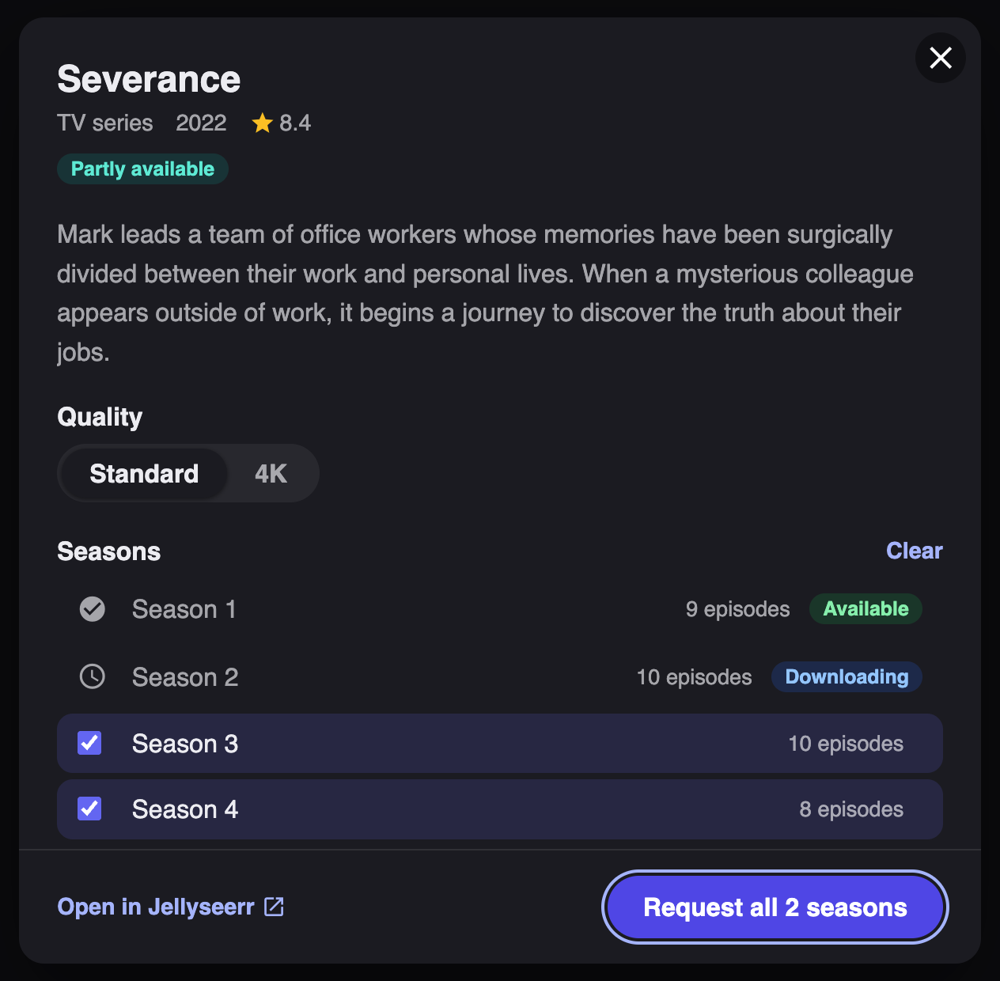
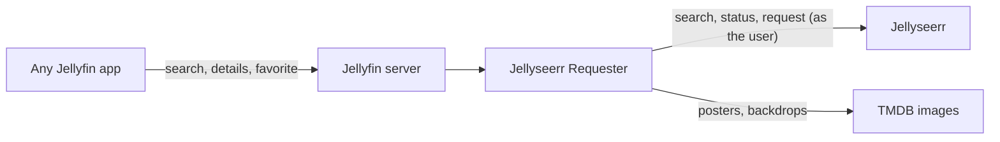

<div align="center">

# Jellyseerr Requester

**Search Jellyseerr from inside Jellyfin, and request what's missing from any app, on any screen.**


[What users get](#what-users-get) ·
[Install](#install) ·
[Configure](#configure) ·
[Client support](#client-support) ·
[Troubleshooting](#troubleshooting) ·
[How it works](#how-it-works)

</div>

---

Your users search in Jellyfin. If a movie or show isn't in your library yet, it still shows up in the results,
straight from [Jellyseerr](https://github.com/Fallenbagel/jellyseerr). One tap on the heart and the request is
on its way. There's no second app to open and no new button to learn, and it works the same on the web,
Apple TV, Android TV, iOS and Android.

<p align="center">
  
  <br>
  <sub>The optional Request dialog in Jellyfin web. In other apps, users request with the heart button.</sub>
</p>

## What users get

### 1. Missing titles in search
Library results come first. Matching Jellyseerr titles that aren't in the library yet follow in the usual
**Movies** and **Shows** rows. Their detail pages have the poster, backdrop, year, rating, genres and runtime,
and the overview starts with *"Not in your library, available to request"*.

### 2. Request with the heart
Every Jellyfin app already has a favorite button, Swiftfin on Apple TV included, so that's the request button.

| Heart on a | Requests |
|---|---|
| **Movie** | The movie |
| **Show** | Every season that isn't already available or requested |
| **Season** | Just that season (open the show, then the season) |

The heart stays filled once the request is in.

### 3. Status on the poster
Posters carry a badge that updates as Jellyseerr does its job:

| Badge | Meaning |
|---|---|
| `+ REQUEST` | Not requested yet |
| `REQUESTED` | Waiting for approval or a download |
| `DOWNLOADING` | On its way |
| `REQUEST MORE` | Some seasons are missing |
| `AVAILABLE` | Ready to watch (shown per season) |

### In Jellyfin web
A **Request** button replaces Play on these titles. It opens a dialog where missing seasons are already selected
(or just the season you're looking at), with an optional **Standard / 4K** choice. Play and Shuffle are
hidden, since there's nothing to play yet.

> [!NOTE]
> Requests are made **as the user's own Jellyseerr account**. Permissions, quotas, auto-approval and
> notifications all work as usual, and the API key never leaves the Jellyfin server.

## Install

1. **Check your Jellyfin version** in *Dashboard → General*, or at `http://<server>:8096/System/Info/Public`.
2. **Get the matching zip** from `dist/`, or [build it](#build):

   | Jellyfin | Zip |
   |---|---|
   | 12.x | `jellyseerr-requester_1.1.0.0_jf12.zip` |
   | 10.11.x | `jellyseerr-requester_1.1.0.0_jf10.11.zip` |

3. **Stop Jellyfin.** Extract `Jellyfin.Plugin.JellyseerrRequester.dll` into
   `<jellyfin config>/plugins/JellyseerrRequester/`, replacing any older copy. In Docker that's usually
   `/config/plugins/JellyseerrRequester/`.
4. **Start Jellyfin.** *Dashboard → Plugins* should list **Jellyseerr Requester** as *Active*.

> [!WARNING]
> Only replace the DLL while Jellyfin is stopped. Overwriting it on a running server can make that run fail when
> it shuts down.

<details>
<summary><b>Or host your own plugin repository</b></summary>
<br>

```sh
REPO_URL=https://your.host/jellyfin-plugins ./build.sh
```

Upload `dist/` (the zips and `manifest.json`) to that URL. Then add
`https://your.host/jellyfin-plugins/manifest.json` under *Dashboard → Plugins → Repositories* and install from
the catalog. Updates then arrive like any other plugin's.

</details>

## Configure

Open *Dashboard → Plugins → **Jellyseerr Requester***. The page tests the saved connection as soon as it opens.
Use **Test connection** again after changing the URL or key.

**Connection**

| Setting | What to enter |
|---|---|
| Jellyseerr URL | The address the **Jellyfin server** uses to reach Jellyseerr, e.g. `http://jellyseerr:5055` |
| API key | In Jellyseerr: *Settings → General → API Key* |
| Public Jellyseerr URL | Optional. The address browsers use for "Open in Jellyseerr" links |

**Search results**

| Setting | Default |
|---|---|
| Add Jellyseerr titles to Jellyfin search | On. The main feature; the options below only apply while it's on |
| Titles per search | 10 movies and 10 shows |
| Leave out titles that are already fully available | On |
| Show the status on posters | On |
| Explain how to request at the top of the overview | On |

**Requests and Jellyfin web**

| Setting | Default |
|---|---|
| Let users without a Jellyseerr account request | Off. When on, unlinked users request as the API key owner |
| Offer 4K requests | Off. Adds the Standard / 4K choice; needs a 4K server in Jellyseerr |
| Request button with season picker | On. Web only; restart Jellyfin after changing it |

### Linking users
Jellyfin users are matched to Jellyseerr users by **Jellyfin user ID**, then by **username**. Anyone imported with
Jellyseerr's *Users → Import Jellyfin Users*, or who signed in to Jellyseerr with their Jellyfin account, is
linked automatically.

Unlinked users still see the titles. The overview tells them to ask an admin, and the heart returns an error.

## Client support

| Client | Titles in search | How to request |
|---|:---:|---|
| Jellyfin web, desktop apps | ✅ | Heart, or the **Request** button and season picker |
| Swiftfin (Apple TV, iOS) | ✅ | Heart |
| Android TV, Android, Jellyfin iOS app | ✅ | Heart |
| Infuse | ❌ | Infuse searches its own copy of your library instead of asking the server |

Pressing **Play** on a title that isn't in the library shows a "no media" error in native apps, because there's
nothing to play yet. Jellyfin web hides those buttons.

## Troubleshooting

<details>
<summary><b>Nothing shows up in search</b></summary>
<br>

1. Check that the plugin is *Active* in *Dashboard → Plugins*.
2. Run **Test connection** on the settings page.
3. Search *Dashboard → Logs* for `Jellyseerr Requester`.
4. Results only appear in *Movies* and *Shows* searches, for queries of at least 2 characters.

</details>

<details>
<summary><b>Posters or statuses look out of date</b></summary>
<br>

Apps cache images by tag. The tag changes with the status, so pull to refresh or reopen the page.

</details>

<details>
<summary><b>"Not linked" errors</b></summary>
<br>

Import the user in Jellyseerr (*Users → Import Jellyfin Users*), or turn on
*Let users without a Jellyseerr account request*.

</details>

<details>
<summary><b>No Request button in Jellyfin web</b></summary>
<br>

The button needs *Request button with season picker* turned on and a Jellyfin restart. Then reload the page
in the browser, bypassing its cache. The heart works either way.

</details>

## How it works



- **Search and items.** An ASP.NET filter wraps Jellyfin's own API (`/Items?searchTerm=…`, `/Search/Hints`).
  It adds Jellyseerr results as *virtual* items with self-describing ids (`4a535252-…`), then answers every
  later call for those ids: details, images, seasons, user data and favorites. Other endpoints (similar items,
  theme media, playback info…) get empty answers instead of errors. Search results are cached for 2 minutes,
  and titles already in the library (matched by TMDB id) are left out.
- **Posters** come from TMDB. The badge is drawn with SkiaSharp, which Jellyfin already ships.
- **Web script** (optional) is loaded through the
  [File Transformation](https://github.com/IAmParadox27/jellyfin-plugin-file-transformation) plugin when it's
  installed, otherwise by patching `jellyfin-web/index.html` at startup.

## Build

Needs the .NET 10 SDK, or Docker.

```sh
./build.sh   # dist/jellyseerr-requester_<version>_jf12.zip and _jf10.11.zip
```

Or one target at a time:

```sh
dotnet publish src/Jellyfin.Plugin.JellyseerrRequester -c Release                          # Jellyfin 12.x
dotnet publish src/Jellyfin.Plugin.JellyseerrRequester -c Release -p:JellyfinTarget=10.11  # Jellyfin 10.11.x
```

<details>
<summary><b>Project layout</b></summary>
<br>

```
src/Jellyfin.Plugin.JellyseerrRequester/
  Plugin.cs, PluginServiceRegistrator.cs   entry point, DI and MVC filter registration
  Configuration/                           settings and the dashboard page
  Jellyseerr/                              Jellyseerr REST client and JSON mapping
  Virtual/VirtualItemFilter.cs             hooks Jellyfin's API (search, details, images, favorites…)
  Virtual/RequesterService.cs              search and title caches, user linking, requests, item DTOs
  Virtual/PosterRenderer.cs                TMDB artwork and status badges
  Virtual/VirtualId.cs                     self-describing virtual item ids
  Api/                                     endpoints used by the web script and the settings page
  Injection/WebInjectionService.cs         web script injection
  Web/jellyseerr-requester.js              web Request button and season picker
docs/                                      README images
```

</details>
